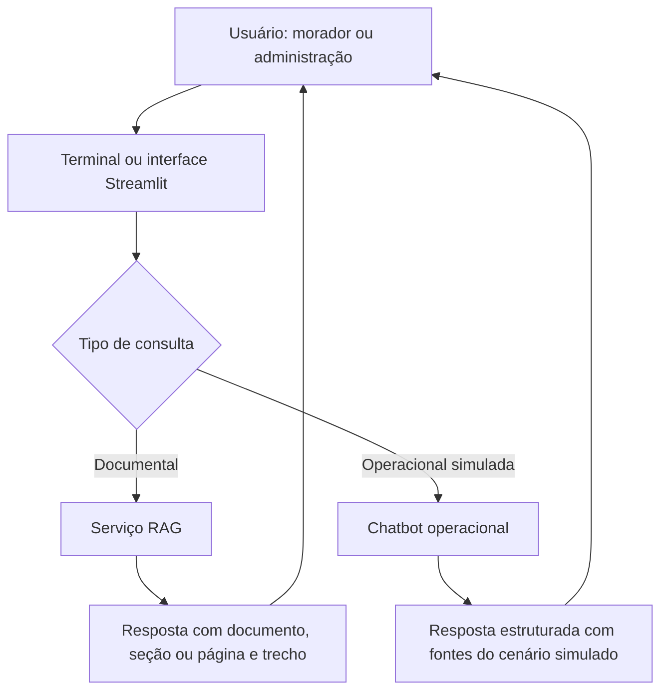
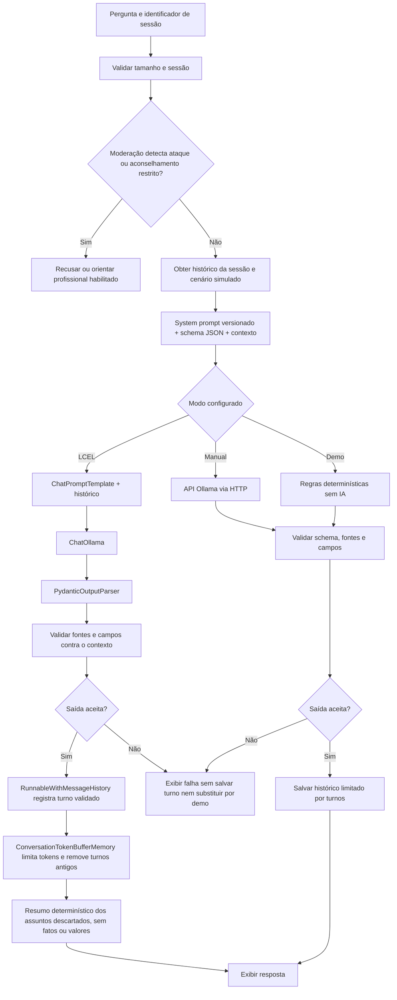
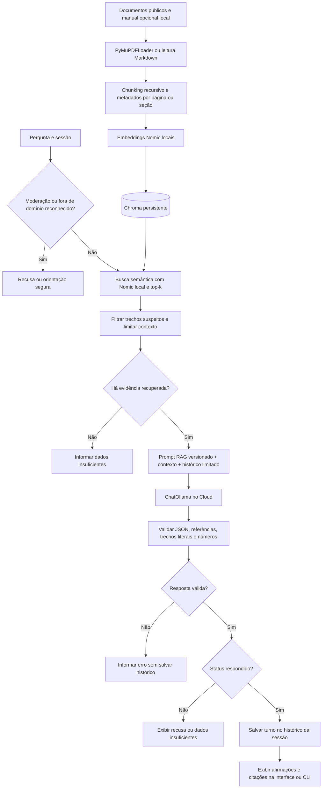

# Fluxograma do ChargeWise AI

Representa a implementação atual, incluindo terminal e interface Streamlit.
GitHub renderiza os diagramas Mermaid abaixo. Não representa uma prova histórica
de entrega da Sprint 1.

## Visão geral

## Consulta operacional e núcleo LCEL

Falhas de conexão e parsing também seguem para a saída de erro. A memória LCEL
atual resume assuntos dos turnos descartados por regras; o resumo compartilha o
orçamento de tokens e não permite reconstruir perguntas exatas. Recusas da moderação não chamam LLM.
Tiktoken estima tokens; contadores do endpoint são registrados quando disponíveis.

## Consulta documental RAG

Citações válidas e filtros são controles técnicos; não garantem correção semântica
universal. Qualidade é avaliada separadamente com RAGAS e revisão das respostas.
